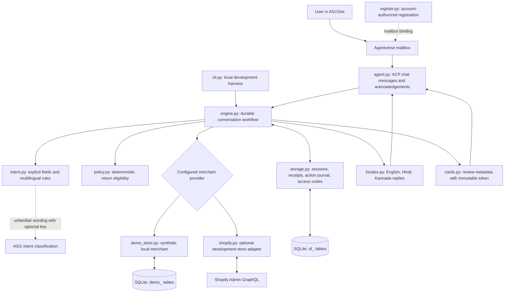
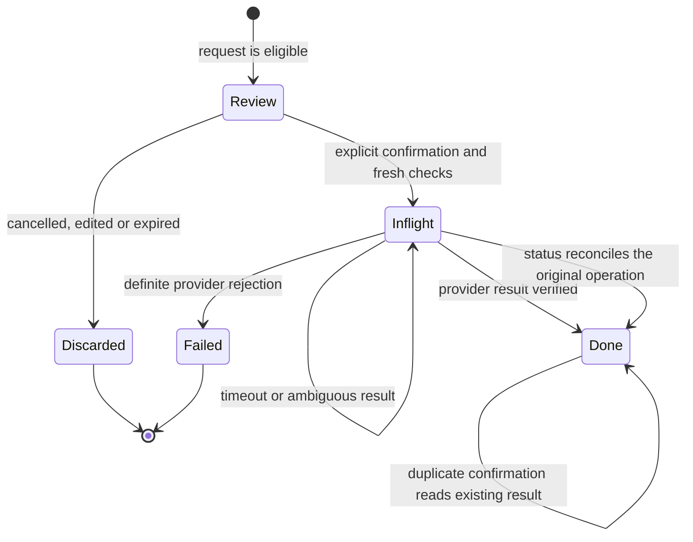

# OrderFix architecture

OrderFix converts a shopper's problem into a reviewed, recorded return request. It separates conversation interpretation, deterministic eligibility, user approval and merchant-side execution so the final reply can be tied to an actual stored result.

## Module graph

The two SQLite table groups may share the same database file. The CLI uses a separate file by default to avoid mixing development conversations with the running agent. This is one coordinating agent with multiple tools, not a multi-agent system.

## Conversation and identity

`agent.py` implements the official chat protocol types from `uagents-core==0.4.12` with `uagents==0.26.1`; the bundled protocol specification is ACP `0.3.0`. Every incoming chat message receives an acknowledgement. Responses contain text and, when enabled, structured review metadata.

The registration helper associates the stable agent identity with the operator's Agentverse account using a privately configured `AGENTVERSE_API_KEY`. Run `python -m orderfix.register --dry-run` to preview public settings, `python -m orderfix.register --register` to register, then `python -m orderfix.agent` to process messages. The agent uses mailbox delivery: the Python process retrieves queued messages, without a public HTTP endpoint or tunnel. This matches the [current Agentverse SDK overview](https://docs.agentverse.ai/documentation/launch-agents/agentverse-sdk/overview). Mailbox connectivity and application hosting are separate; the operator still needs a running process and network access.

The owner key hashes the authenticated transport sender together with the transport session. Session state, message receipts, reviews and action records use that owner. A token from one conversation cannot confirm another conversation's review. Staying in the same ASI:One conversation is therefore part of the demo workflow.

In demo mode the owner receives a synthetic customer namespace. The merchant backend lazily seeds five scenarios and stores their original timestamps permanently. The same sample order number in another conversation represents a different synthetic order. This allows multiple judges to try the demo independently.

In Shopify test mode the session must redeem a merchant-issued, expiring invitation for a specific test customer. Invitations are hashed in storage and bound to one owner. This mechanism is intentionally scoped to controlled demonstration customers; it is not real-shopper identity verification.

## Planning and tool execution

1. Interpret the request and collect an explicit order, item, quantity and return reason.
2. Read the customer's order from the selected provider.
3. Check fulfillment, the return window, exclusions and the currently available quantity.
4. Store a review containing the exact order ID, line ID, quantity, reason and random confirmation token.
5. Wait for explicit `confirm TOKEN` or the equivalent structured card action.
6. Re-read the order and recheck eligibility immediately before dispatch.
7. Journal the operation, submit it once and verify the returned facts against the approved review.
8. Save the result and return the verified request ID and status.

The four user-facing features are order lookup, return eligibility, return submission and return status. The engine also handles cancellation of an unsubmitted review, language changes, expired reviews, retries and uncertain outcomes.

`intent.py` extracts critical identifiers and quantities from explicit user text. Optional ASI1 classification can suggest an action and reason for unfamiliar language. It cannot authorize writes, supply hidden order identifiers or bypass the policy. The offline rules support the documented English, Hindi and Kannada flows without an API key.

## Action journal and recovery

Message receipts prevent a repeated transport message from running the turn again. The action journal independently prevents a new message containing the same confirmation token from dispatching another return.

Before a merchant write, the journal commits an operation ID and the approved review. Only one unresolved action per owner can exist. If a response is lost, the agent retains that operation and reconciles it through the provider. It does not clear the unresolved action on `reset`, `new`, a different order lookup or a replacement return request. If reconciliation still cannot verify the result, the user sees an uncertainty message and no new action is sent.

Verification checks the order ID, line ID, quantity, reason, operation ID and provider mode. A mismatching response is not reported as success. A database failure after the merchant action can be recovered from the earlier journal entry and provider readback.

Review tokens expire after 15 minutes. Ordinary conversational sentences, negated confirmations and JSON carrying additional fields cannot authorize the action. Changing return details creates a new review; the prior unsubmitted token becomes invalid.

## Merchant adapters

### Persistent demonstration store

`demo_store.py` uses real SQLite writes with synthetic business data. A `BEGIN IMMEDIATE` transaction rechecks persisted order ownership, policy and remaining quantity before insertion. A unique `(customer_ref, operation_id)` constraint prevents duplicate operations. Reusing an operation ID with a changed payload is rejected.

The backend calculates remaining quantity from saved return requests. Requests that reserve stock cannot be duplicated past the original order quantity, even when callers hold stale order objects. The method reads the record after commit before returning success. Restarting preserves both return records and sample fulfillment dates.

### Optional Shopify test adapter

`shopify.py` reads customer-scoped orders and returnable fulfillment lines using Admin GraphQL `2026-10`. Its only write is `returnRequest`; no refund, shipment or approval mutation is implemented. A stable operation marker in the return note supports reconciliation, followed by a fresh read to verify the result.

Incomplete or oversized paginated data fails closed instead of silently assuming there are no additional returns or order lines. HTTP responses, timeouts, malformed data and uncertain mutations have dedicated error paths. The adapter is covered by mocked tests and has not been validated against a live Shopify development store.

The policy module currently implements the demonstration policy. A production deployment needs the merchant's actual policy, authentic customer verification, operational review of unresolved requests and live API validation.

## Languages and cards

`locales.py` stores authored templates for English (`en`), Hindi (`hi`) and Kannada (`kn`). Transaction facts remain structured values; the application does not ask an LLM to invent or translate return IDs, amounts or policy outcomes. Product names retain the source store's wording.

`cards.py` emits ACP `MetadataContent` with a review payload and confirmation/cancellation selections. Each selection refers to the same stored review token. Text confirmation remains available. Metadata construction is tested; actual ASI:One rendering must be recorded as a separate live validation result.

## Operational scope

The intended deployment runs one agent process against persistent local SQLite storage. A global engine lock serializes turns, with bounded handling time and a per-owner request limit. SQLite protects merchant writes independently. The implementation is not presented as a horizontally scaled service.

The private agent seed keeps the address stable. `.env`, databases, generated credentials and logs are ignored by Git. Audit events contain correlation identifiers and outcomes rather than full customer messages or secret API responses.

Local verification recorded on 23 October 2026: **159 automated tests passed**, and scripted English, Hindi and Kannada flows completed. These checks cover application behavior and ACP handler contracts; they do not establish Agentverse discovery, ASI:One card rendering, live Shopify correctness or hosted uptime.
